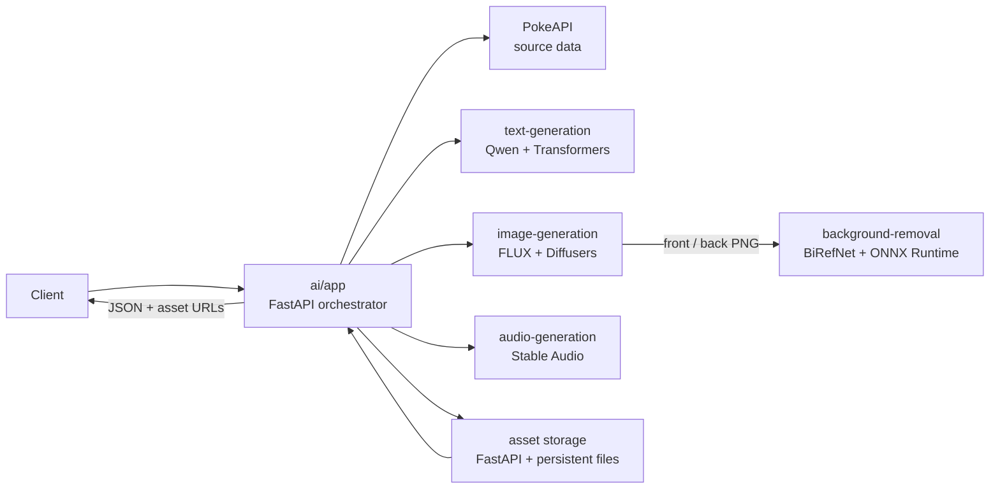

# AI services: architecture and reuse guide

This document describes the AI stack under [`ai/`](ai/) and how its service pattern can be reused to build custom AI applications and agents.

## Overview

The system is a Python application that coordinates several independently hosted model services. It uses a language model to define a creature, an image model to create front and back views, a segmentation model to make the backgrounds transparent, and an audio model to generate a cry. A small storage service persists the finished files and returns URLs.

The models are separate HTTP services, so the coordinating app can focus on the task and each model can use its own dependencies, runtime, and GPU settings.



## How a generation works

The main entry points are `POST /generateByType` and `POST /generateById` on the central app. Both build a complete result; the first chooses a random existing Pokemon of a requested type, and the second uses a specified Pokemon ID. The app fetches source data from the public PokeAPI, then:

1. Reads the Pokemon's type labels and chooses a compatible body plan. It also chooses a naming style, description tone, and focus. These choices and the detailed prompt templates are in [`ai/app/random_choices.py`](ai/app/random_choices.py) and [`ai/app/main.py`](ai/app/main.py).
2. Sends a constrained prompt to the text service. The text service returns a name and description as JSON. The app uses that result to compose separate front-view and back-view image prompts.
3. Asks the image service to create the front view. It then submits that image as a reference when requesting the back view, which helps preserve the same creature's identity.
4. Sends each generated image to the background-removal service. That service returns a PNG with an alpha transparency mask.
5. Requests a creature cry from the audio service using the description.
6. Uploads both PNGs and the WAV file to storage. Storage writes them to persistent directories and returns public URLs.
7. Adds the generated name, description, sprite URLs, and cry URL to the Pokemon data and returns the combined JSON response.

After text generation, front-image generation and audio generation can run at the same time when `AI_PARALLEL_MODEL_CALLS=true`. Back-image generation waits for the front image because it uses it as a reference. The default is sequential execution. The app logs elapsed time per stage, applies request timeouts, and converts downstream service failures into HTTP 502 errors.

The app also offers `POST /generateImage` for a generated front image and `POST /generateCry` for audio directly. These return PNG and WAV responses respectively, instead of storing files and returning the combined Pokemon response. Each service exposes `GET /health` for container health checks.

## What each service does

| Component | Technology and role |
| --- | --- |
| [`ai/app/`](ai/app/) | Python 3.12, FastAPI, Pydantic, and `requests`. Validates requests, fetches source data, selects design constraints, builds prompts, calls model APIs, coordinates optional parallel work, and stores the finished assets. It does not load large models itself. |
| [`ai/text-generation/`](ai/text-generation/) | FastAPI with PyTorch and Hugging Face Transformers. Loads `Qwen/Qwen2.5-VL-3B-Instruct`, applies the chat template, and samples a JSON name/description. The endpoint checks the structure, retries once if the response is invalid, and normalizes text to ASCII. |
| [`ai/image-generation/`](ai/image-generation/) | FastAPI, PyTorch, Hugging Face Diffusers, and Transformers. Loads `black-forest-labs/FLUX.2-klein-4B` with the `Limbicnation/pixel-art-lora` adapter. It exposes text-to-image front generation and image-conditioned back generation. The implementation uses 4-bit quantization for major components, BF16 on CUDA, and configurable image size and inference steps. |
| [`ai/background-removal/`](ai/background-removal/) | FastAPI, Pillow, NumPy, and ONNX Runtime GPU, with TensorRT as a preferred execution provider when available. Runs `studioludens/birefnet-lite-512`, turns its segmentation output into an alpha mask, and returns a transparent PNG. It falls back through CUDA and CPU providers if TensorRT is unavailable. |
| [`ai/audio-generation/`](ai/audio-generation/) | FastAPI, PyTorch, torchaudio, and Stable Audio 3. Loads the `small-sfx` model and generates a one-second WAV sound effect from a text description. |
| `storage/` | A lightweight FastAPI file service. Writes sprites and audio to mounted storage, then serves them by URL. Docker Compose gives it a persistent volume so container replacement does not discard generated files. |

The configured model repositories are implementation choices, not requirements of the architecture. They can be replaced by other compatible models or by hosted model APIs while keeping the same service contracts.

## Technology and deployment pattern

Each component has its own Dockerfile and Python dependencies. Docker Compose connects them on a private service network: the app calls names such as `text-model:8000` and `image-model:8000`; the model services do not need public host ports. The app is mapped to host port `8001`, and storage is mapped to `8002` by default. Model containers load their weights on startup and report health before Compose starts the dependent app. Model weights are downloaded during image builds and loaded locally at runtime, which avoids needing a model-host connection for every inference.

The model services use GPU acceleration when configured and available. Compose requests GPUs for those containers, and per-service `AI_*_GPU` settings can select visible GPU devices. Running this setup therefore requires a Docker host configured for NVIDIA GPU access and enough GPU memory for the chosen models. Model loading can make first builds and container startup take considerably longer than the small FastAPI app. The background-removal service also keeps a TensorRT engine cache in a Docker volume.

Hugging Face credentials are provided as a Docker build secret for model downloads. Keep tokens in the local environment or a secret manager; do not commit them to source control or place them in this document. Runtime settings such as model IDs, generation settings, service URLs, and parallel execution are configurable through environment variables and Compose.

This Compose file expects a local `ai/.env` runtime environment file, which is ignored by Git. Create it before starting the stack, even if you leave it empty. If a model repository requires authentication, make `HF_TOKEN` available to Docker Compose through the host environment or the root Compose `.env` file; Compose passes it to model builds as a secret.

The Compose definitions for the AI services are in [`docker-compose.yml`](docker-compose.yml). Once required model access and local environment settings are configured, the stack can be started with:

```sh
docker compose up --build ai-app
```

This starts `ai-app` and the services it declares as dependencies. For example, generate a complete creature using a type:

```sh
curl -X POST http://localhost:8001/generateByType \
  -H 'Content-Type: application/json' \
  -d '{"type":"fire"}'
```

The response includes the source Pokemon data plus the generated name and description and URLs for the front sprite, back sprite, and latest cry.

## Reusing this stack for a custom AI application

The reusable pattern is the separation of **coordination** from **inference**:

1. **Define a task and its inputs.** Use Pydantic request models and clear API contracts for user requests and model results.
2. **Build an orchestrator.** Put domain logic, context gathering, prompt construction, validation, and sequencing in a small FastAPI service. Keep large model libraries and weights out of this service.
3. **Expose each model behind a service API.** Give each model a focused endpoint, such as `/generate`, `/classify`, or `/transcribe`. A service can run a local open-weight model or call a hosted provider; the orchestrator can use either over HTTP.
4. **Make outputs explicit and checkable.** Ask models for structured output where possible, validate it, retry only when appropriate, and return clear errors when a dependent service fails.
5. **Persist large outputs separately.** Store images, audio, or documents in file or object storage and return URLs or identifiers, instead of embedding large binary payloads in JSON.
6. **Package and operate the pieces independently.** Use Docker images, Compose networking, health checks, timeouts, useful stage-level logs, and GPU-aware configuration. Separate services can be scaled or updated according to their own resource needs.

For a company-specific assistant, the same architecture can coordinate a text model with internal search, databases, document processing, or business APIs. Start with a bounded workflow and a few well-defined tools; add authentication, access controls, auditing, and human review for actions that affect company data or systems.

One useful presentation distinction: this repository demonstrates a **fixed multi-model workflow**. Its app chooses the steps in advance; the language model supplies content but does not plan actions, choose tools, or maintain conversational memory. To turn this service pattern into an agent, add an agent controller that can select among explicitly defined tools, track task state, enforce limits and permissions, and decide when a task is complete. The existing model services and storage API can then act as tools the controller calls.

## Code map

- [`ai/app/main.py`](ai/app/main.py): API endpoints, orchestration, prompt templates, downstream calls, timing, and response assembly.
- [`ai/app/random_choices.py`](ai/app/random_choices.py): type-specific body plans and palettes plus randomized description and naming guidance.
- [`ai/app/asset_storage.py`](ai/app/asset_storage.py): upload contract between the orchestrator and storage.
- [`ai/text-generation/app/main.py`](ai/text-generation/app/main.py): text model loading, decoding, structured-response checks, and normalization.
- [`ai/image-generation/app/main.py`](ai/image-generation/app/main.py): image model loading, quantization, front/back inference, and PNG response handling.
- [`ai/background-removal/app/main.py`](ai/background-removal/app/main.py): ONNX Runtime setup, provider fallback, segmentation mask, and transparent PNG output.
- [`ai/audio-generation/app/main.py`](ai/audio-generation/app/main.py): audio model loading and WAV generation.
- [`storage/main.py`](storage/main.py): asset persistence and public file routes.
