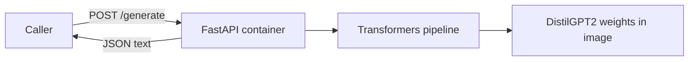

# How to run a simple AI model in Docker

This guide builds a small, local text-generation API with Python, FastAPI, Hugging Face Transformers, PyTorch, and Docker Compose. It runs on CPU and does not require an API key or GPU.

The example uses [DistilGPT2](https://huggingface.co/distilbert/distilgpt2), a compact English text-generation model. It continues a prompt; it is not an instruction-following chat model, so expect completions rather than reliable answers to questions. The same container pattern can host other compatible models.

## What you will build



The model runs inside the container. The API accepts a JSON prompt and returns generated text. Docker downloads the public model while building the image, so the running service can load it from local files.

## Prerequisites

- Docker Desktop or Docker Engine with Docker Compose.
- An internet connection during the first image build so Docker can download Python packages and model weights.
- A few gigabytes of disk space for the image and model files. CPU generation is slower than GPU generation.

## 1. Create the project files

Create a folder such as `my-text-model` with these files:

```text
my-text-model/
|-- app.py
|-- requirements.txt
|-- Dockerfile
`-- compose.yaml
```

### `requirements.txt`

```text
fastapi
uvicorn[standard]
transformers
```

### `app.py`

```python
from contextlib import asynccontextmanager
from threading import Lock
import os

from fastapi import FastAPI, HTTPException
from pydantic import BaseModel, Field
from transformers import pipeline


text_generator = None
generation_lock = Lock()
MODEL_PATH = os.getenv("MODEL_PATH", "/opt/model")


@asynccontextmanager
async def lifespan(app: FastAPI):
    global text_generator
    # Load the weights once when the service starts, then reuse them per request.
    text_generator = pipeline(
        "text-generation",
        model=MODEL_PATH,
        device=-1,  # CPU
    )
    yield
    text_generator = None


app = FastAPI(title="Simple Text Model", lifespan=lifespan)


class GenerateRequest(BaseModel):
    prompt: str = Field(min_length=1, max_length=2000)
    max_new_tokens: int = Field(default=60, ge=1, le=120)


@app.get("/health")
def health():
    return {"status": "ok", "model_loaded": text_generator is not None}


@app.post("/generate")
def generate(body: GenerateRequest):
    if text_generator is None:
        raise HTTPException(status_code=503, detail="Model is not ready")

    # A single in-process model instance handles one inference at a time.
    with generation_lock:
        prompt_tokens = text_generator.tokenizer(body.prompt)["input_ids"]
        model_config = text_generator.model.config
        context_window = getattr(model_config, "max_position_embeddings", None)
        if context_window is None:
            context_window = getattr(model_config, "n_positions", 1024)
        if len(prompt_tokens) + body.max_new_tokens > context_window:
            raise HTTPException(
                status_code=422,
                detail="Prompt and requested completion exceed the model context window",
            )

        result = text_generator(
            body.prompt,
            max_new_tokens=body.max_new_tokens,
            do_sample=True,
            temperature=0.8,
            top_p=0.95,
            return_full_text=False,
            pad_token_id=text_generator.tokenizer.eos_token_id,
        )

    return {"text": result[0]["generated_text"]}
```

The pipeline loads the model once at container startup. `max_new_tokens` limits the size of each completion, and the lock prevents two requests from using this one model instance at the same time. The API is intentionally small; production services should also add authentication, request limits, monitoring, and an appropriate concurrency or queue strategy.

### `Dockerfile`

```dockerfile
FROM python:3.12-slim

WORKDIR /app
ENV PYTHONDONTWRITEBYTECODE=1
ENV PYTHONUNBUFFERED=1

COPY requirements.txt .

# Install the CPU build of PyTorch for this CPU-only example.
RUN pip install --no-cache-dir --upgrade pip \
    && pip install --no-cache-dir torch --index-url https://download.pytorch.org/whl/cpu \
    && pip install --no-cache-dir -r requirements.txt

# Fetch public model weights during the image build, not on each API request.
ARG MODEL_ID=distilbert/distilgpt2
ENV MODEL_ID=${MODEL_ID}
RUN python -c "import os; from huggingface_hub import snapshot_download; snapshot_download(repo_id=os.environ['MODEL_ID'], local_dir='/opt/model')"

ENV MODEL_PATH=/opt/model
COPY app.py ./

EXPOSE 8000
CMD ["uvicorn", "app:app", "--host", "0.0.0.0", "--port", "8000"]
```

The model weights are part of the built image. Changing `MODEL_ID` requires rebuilding the image. For a large model, consider mounting a persistent model cache or downloading the model at container startup; either option trades image size against startup time and network dependence.

### `compose.yaml`

```yaml
services:
  text-model:
    build: .
    ports:
      - "127.0.0.1:8000:8000"
    restart: unless-stopped
```

Compose builds the Dockerfile from the current project folder and publishes the API on port `8000` of your machine's loopback interface. The model has no authentication in this example. If you change the port mapping to make it reachable from a network, add authentication and other appropriate access controls first.

## 2. Build and start the service

From inside `my-text-model`, run:

```sh
docker compose up --build -d
```

The first build installs the Python packages and downloads the model files. Later starts reuse the built image. Check startup logs and confirm the service is healthy:

```sh
docker compose logs -f text-model
```

```sh
curl http://localhost:8000/health
```

The health response should include `"model_loaded": true` after startup completes.

## 3. Send a prompt

On macOS or Linux, use cURL:

```sh
curl -X POST http://localhost:8000/generate \
  -H 'Content-Type: application/json' \
  -d '{"prompt":"In a quiet forest,","max_new_tokens":40}'
```

On Windows PowerShell, use `Invoke-RestMethod`:

```powershell
$body = @{ prompt = 'In a quiet forest,'; max_new_tokens = 40 } | ConvertTo-Json
Invoke-RestMethod -Uri 'http://localhost:8000/generate' -Method Post -ContentType 'application/json' -Body $body
```

The response is JSON, for example:

```json
{"text":" the wind moved softly through the trees..."}
```

Generated text varies from request to request. DistilGPT2 is a base text-completion model, so it may continue the prompt in unexpected ways and should not be treated as a reliable assistant or source of facts.

## 4. Stop the service

```sh
docker compose down
```

To also remove the built image, use `docker compose down --rmi local` from this project folder.

## Use a different model

Choose a model that is compatible with the Transformers `text-generation` pipeline, and check its license, intended use, memory requirements, and model card. For a public model, change the Docker build argument:

```yaml
services:
  text-model:
    build:
      context: .
      args:
        MODEL_ID: your-org/your-model
```

Then rebuild with `docker compose up --build`. For gated or private Hugging Face models, use a Docker BuildKit secret to provide the access token during model download. Do not put tokens in the Dockerfile, a build argument, or a committed Compose file. The [`ai/text-generation/Dockerfile`](ai/text-generation/Dockerfile) shows the BuildKit secret pattern used in this repository.

The sample is explicitly configured for CPU with `device=-1` and a CPU PyTorch wheel. To use a GPU, install a PyTorch build that matches the target hardware, set the Transformers pipeline device accordingly, and configure Docker GPU access for the host and container. The GPU setup varies by hardware, driver, and container runtime; the [PyTorch installation selector](https://pytorch.org/get-started/locally/) provides the matching package command.

## How this relates to the AI services in this repository

This small service uses the same core pattern as [`ai/text-generation/`](ai/text-generation/): a FastAPI app loads a Transformers model at startup and exposes a JSON endpoint, packaged in its own Docker image. The repository's model service uses a larger instruction-tuned model and includes structured-output validation; this tutorial keeps the endpoint minimal so the container lifecycle and HTTP interface are easy to follow.

The service created here is a model API, not an agent. An agent would add a coordinating application that decides what task to perform, which tools or model services to call, and when the task is done. See [`README-AI.md`](README-AI.md) for how this repository separates orchestration from model inference.

## References

- [DistilGPT2 model card](https://huggingface.co/distilbert/distilgpt2)
- [Transformers text-generation pipeline](https://huggingface.co/docs/transformers/main_classes/pipelines)
- [PyTorch CPU installation guidance](https://pytorch.org/get-started/locally/)
- [Docker Compose build documentation](https://docs.docker.com/reference/compose-file/build/)
